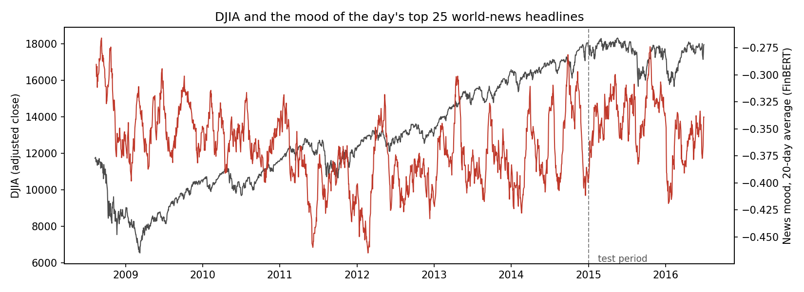

# Headline Mood Check: What News Sentiment Did and Didn't Tell Us About the Dow

**Track:** Finance
**Team:** Jinwon Song, Sangjun Ha
**Code:** [Colab notebook (with outputs)](https://colab.research.google.com/drive/1zQQknPNWd2NqP9bjZDAM8-0F7OqSaSTZ?usp=sharing)

> This project is a prototype and is not financial advice.

## The problem

A beginner investor reads the morning headlines and wonders whether to buy or sell that day. Many people believe the news mood tells them where the market is going next, but they have no way to check that belief before they act. Acting on an unchecked belief is how small investors lose money on noise.

## What we built

A "date card" for one trading day. You give it a date, and it uses that day's 25 real world-news headlines to show:

1. How negative the day's news was, compared with every day in 2008-2014
2. The three most negative and three most positive headlines
3. A model's estimate that the Dow Jones Industrial Average (DJIA) closes up on the next trading day, and the two inputs that moved the estimate most
4. The model's track record in 2015-2016 next to two simple guesses, with the margin of chance
5. A plain sentence saying whether that track record is good enough to act on (it is not)

The user's moment is right before they press "buy" or "sell" because of the news. The card puts the evidence next to the feeling.

Example (an ordinary day, picked with a fixed random seed):

```
=== Headline Mood Check: 2015-06-18 ===
1. Today's news mood: more negative than 28% of days in 2008-2014 (FinBERT: 14 negative, 7 neutral, 4 positive).
3. Model estimate that the Dow closes up on 2015-06-19: 66%
   - how mixed the headlines were pushed the estimate up
   - most positive headline pushed the estimate down
4. Track record on 2015-16 (378 days, about +/-5 points of chance):
   this model 49.8% | always guess 'up' 50.8% | same as previous day 45.8%
5. News mood alone did not beat simply guessing 'up' in 2015-16 (49.8% vs 50.8%),
   so this 66% estimate is not a reason to trade on its own.
6. This project is a prototype and is not financial advice.
```

This is an index-level analysis of the Dow Jones Industrial Average, not an analysis of individual companies. The card only accepts dates in our 2015-2016 test period, so it never shows a day the model was trained on.

## What we added

We started from the suggested project "News headlines and the stock market" (Project Briefs 4.2.4) and added:

- **Our own user:** a beginner investor at the moment they want to trade on the news, and a date card designed for that moment.
- **Our own question 1:** can the headlines a person could actually read *before* a trading day (day t-1) predict that day's direction, compared with the brief's same-day setup (day t)?
- **Our own question 2:** does news mood relate to the *size* of the next market move, not only its direction?
- **Our own data:** 40 randomly chosen 2008-2014 headlines labeled positive / neutral / negative for how they would make a US stock investor feel (labeled by Sangjun Ha with help from ChatGPT; saved in `data/headline_labels_40.csv`), to check whether FinBERT, a model trained on financial text, reads world-news headlines that way.
- **A tested and rejected part:** we tried a small open language model to write the card's explanation, measured how often it was right, and removed it from the card (see "Where it fails").

## How it works

**Data.** Kaggle "Daily News for Stock Market Prediction": `Combined_News_DJIA.csv` (1,989 trading days, 2008-08-08 to 2016-07-01, top 25 headlines per day, label 1 if the DJIA rose or stayed the same) and the DJIA price table `DJIA_table.csv`. Cleaning: removed the `b'...'` wrapper found on about 24% of headlines and left the 7 empty headline cells empty. We checked that the label matches "adjusted close at or above the previous day" on 99.9% of days.

**Split by date, never at random.**

| Part | Dates | Days | Share of up days |
|---|---|---|---|
| Train | 2008-08-08 to 2013-12-31 | 1,359 | 54.0% |
| Validation | 2014 | 252 | 55.2% |
| Test (used once) | 2015-01-02 to 2016-07-01 | 378 | 50.8% |

All settings were fixed before we looked at the test period. After the validation check, the final model was retrained on 2008-2014.

**Step 1, FinBERT.** Each of the 49,718 headlines gets a score = P(positive) - P(negative), from -1 to +1, using the pretrained model `ProsusAI/finbert` without changes.

**Step 2, daily features (8).** Mean, minimum, maximum and spread of the day's scores, share of negative and of positive headlines, 5-day average mood, and change from the previous day.

**Step 3, LightGBM.** A small, strongly regularized model (200 trees of 4 leaves, learning rate 0.03, at least 40 days per leaf), because there are only about 1,600 training days and the signal is weak. Problem A uses day t's headlines for day t. Problem B uses day t-1's headlines for day t. We report the mean of 5 random seeds. The card uses Problem B, and its reasons come from LightGBM's per-feature contributions.

**Why these models.** FinBERT turns text into numbers without us training a language model. LightGBM works well on small tables and can show which input moved each estimate.

## Results

**Direction of the Dow, test period 2015-2016 (378 days)**

| Model | Validation 2014 | Test 2015-16 | 95% range (test) | Days predicted "up" |
|---|---|---|---|---|
| LightGBM, Problem A (same-day headlines) | 56.6% | 46.8% (seeds 46.3 to 47.4) | 42.1 to 52.1 | 79% |
| LightGBM, Problem B (previous-day headlines) | 51.7% | 49.8% (seeds 48.9 to 50.5) | 45.0 to 55.0 | 79% |
| Baseline: always "up" | 55.2% | 50.8% | 45.8 to 55.8 | 100% |
| Baseline: same as previous day | 48.8% | 45.8% | 40.7 to 50.8 | - |

Neither model beat the simplest guess. With 378 test days, about +/-5 points can come from chance alone, and both models are inside that range of "always up".

Two details matter. Problem A looked better than "always up" on 2014 (56.6% vs 55.2%) and then fell to 46.8% on 2015-16: a result that looks good in one period may not carry over. Problem A is also *worse* than Problem B, which is the opposite of what a leak from same-day information would cause.

**Mood and the size of moves (Spearman rank correlation)**

Before looking, we set a rule: we would only call a relationship real if it pointed the same way in both periods and had p < 0.05 in both.

| Relationship | 2008-2014 | 2015-2016 | Passes our rule? |
|---|---|---|---|
| Mood vs same-day return | 0.019 (p=0.44) | 0.030 (p=0.56) | No |
| Mood vs next-day return | 0.026 (p=0.29) | 0.135 (p=0.009) | No, only in 2015-16 |
| Share of negative headlines vs size of same-day move | -0.083 (p=0.001) | 0.001 (p=0.99) | No, only in 2008-14 |
| Share of negative headlines vs size of next-day move | -0.061 (p=0.014) | -0.059 (p=0.26) | No |

No relationship passed. One example of why the rule matters: in 2015-16, the least negative fifth of days was followed by an up day 60.2% of the time, which looks like a pattern. In the seven years before, the same fifth was followed by an up day 54.2% of the time, no different from the other fifths (51-57%).



**Our 40 labels vs FinBERT**

The 40 headlines were drawn with a fixed seed from 2008-2014 only, and the labels were set before we looked at FinBERT's labels for them. They were labeled by Sangjun Ha with help from ChatGPT, so this is a check against a second judgment, not a fully independent human panel.

| | Ours | FinBERT |
|---|---|---|
| Negative | 32 (80%) | 19 (47.5%) |
| Neutral | 7 (17.5%) | 20 (50%) |
| Positive | 1 (2.5%) | 1 (2.5%) |

Agreement was 55% (22 of 40) and Cohen's kappa was 0.15, which is only slight agreement beyond chance. In 14 of the 18 disagreements, we called a headline negative and FinBERT called it neutral, for example "Rocket strike that killed 12 Afghan civilians..." and "Hizbullah outs 10 CIA spies on Lebanese television". FinBERT looks for financial wording, so violent or political news without money words often comes out neutral, even though an investor may read it as bad news. FinBERT's mood score may therefore not measure what our user feels when reading the news, which is one possible reason it found no signal.

## Where it fails

- **The model's most confident mistakes.** On 2015-09-28 the model gave a 72% chance of an up day and the Dow fell 1.92%. On 2015-10-14 it also gave 72% and the Dow fell 0.92%. The headlines the day before were about a stampede in Mecca, refugees and human rights. These 25 world-news headlines often contain no economic news at all, so the market-moving information may simply not be in the data.
- **FinBERT misreads world news.** It agreed with our labels only slightly (kappa 0.15, above). "World poverty rate to fall below 10% for the first time ever" was scored among the most negative headlines of its day, probably because "fall" usually means falling prices in financial text. "North Korea says preparation for military action is complete" was scored among the most positive headlines of 2015-08-21.
- **The small language model was not safe to show.** We tested `Qwen2.5-1.5B-Instruct` three times on separate sets of 20 test days, with an automatic check for numbers, banned advice words and sentence length.

| Try | Passed the automatic check | Usable after a stricter check |
|---|---|---|
| 1. Explain the card's numbers | 8 of 20 | not re-checked |
| 2. Same, revised prompt | 13 of 20 | 0 of 20 (all 13 were cut off mid-sentence) |
| 3. Name the day's topics, no numbers | 0 of 20 | - |

Reading the outputs showed errors our check could not catch: an estimate "57% chance of an up day" became "correct 57% of the time", a 66% estimate became "about $66 higher", and claims became facts ("Missing MH370 found" from a headline that put 'found' in quotes; "Greece wipes debt" from a headline about one Greek bank). We removed the model from the card, which now uses a fixed template sentence.

## What these results would and wouldn't justify

They would justify a beginner investor treating a scary or cheerful news day with caution before trading: in our test, the day's headline mood did not tell us the Dow's direction better than always guessing "up".

They would not justify buying or selling because of the news mood, using this tool for any period after July 2016, or drawing conclusions about individual companies. These results alone should not be used to decide whether to buy or sell.

## What we'd do next

- Test financial headlines matched to specific companies, where news is more likely to carry market information.
- Measure whether seeing the card actually changes what beginner investors decide, which we did not test.

## Team

| Person | Contribution |
|---|---|
| Jinwon Song | Chose the topic, user and data range; prepared the data; ran the Colab notebook and checked every result; submitted the project |
| Sangjun Ha | Labeled the 40 headlines (with ChatGPT's help); reviewed this write-up; wrote the demo video script |

## Sources and licenses

- Data: `Combined_News_DJIA.csv` from the "Daily News for Stock Market Prediction" dataset named in the Project Briefs, and the DJIA price table `DJIA_table.csv`, both downloaded from this Kaggle copy: https://www.kaggle.com/datasets/goodenoughzhenlei/combined-news-djiacsv. The Kaggle page lists the license as "Unknown", so we use the data only for this non-commercial student project and do not copy the data files into this repository.
- Sentiment model: FinBERT, `ProsusAI/finbert`, https://huggingface.co/ProsusAI/finbert. Model weights are licensed CC BY-NC-SA 4.0 (non-commercial, share-alike). We use the model unmodified, load it from Hugging Face at run time, and do not redistribute its weights. The model page lists its Financial PhraseBank training data as CC BY-NC-SA 3.0. Citation: Araci, D. (2019). FinBERT: Financial Sentiment Analysis with Pre-trained Language Models. arXiv:1908.10063.
- Small language model (tested, not used in the final card): Qwen2.5-1.5B-Instruct, https://huggingface.co/Qwen/Qwen2.5-1.5B-Instruct, Apache License 2.0.
- Libraries: LightGBM, pandas, NumPy, SciPy, scikit-learn, Matplotlib, Hugging Face Transformers, PyTorch.
- Tools: Google Colab. Claude (Anthropic) helped plan the project, draft code and draft this write-up; the team ran every step and checked the results. ChatGPT (OpenAI) helped Sangjun Ha label the 40 headlines.
