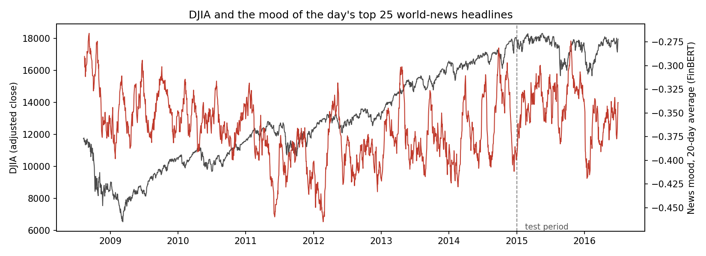

# Headline Mood Check: full results and details

This page holds the full tables behind the one-page write-up in the [README](../README.md).

> This project is a prototype and is not financial advice.

## Notebooks

- **MVP notebook**: https://colab.research.google.com/drive/1e1bwrv5ZGxxx1sQyUpnvW9UiBdnr5-yF?usp=sharing. Part 1 splits the data, Part 2 builds the model on the ML set only, Part 3 scores the test set, Part 4 is the tool. A copy of its code without outputs is in [`headline_mood_mvp.ipynb`](../headline_mood_mvp.ipynb).
- **Experiment log notebook**: https://colab.research.google.com/drive/1zQQknPNWd2NqP9bjZDAM8-0F7OqSaSTZ?usp=sharing. This is the notebook we worked in. It has the same pipeline in the order we built it, plus the full small-language-model trial.

To run the MVP notebook: choose a GPU runtime and run all cells. It downloads the two data files from the Kaggle page in the README's Sources and our label file from this repository; if a download fails, it asks you to upload the file instead. Scoring all headlines with FinBERT takes about 8 minutes on a T4 GPU.

## Data and split

`Combined_News_DJIA.csv` has 1,989 trading days from 2008-08-08 to 2016-07-01, the top 25 world-news headlines per day, and a label that is 1 if the DJIA rose or stayed the same. Cleaning: we removed the `b'...'` wrapper found on about 24% of headlines and left the 7 empty headline cells empty, which leaves 49,718 headlines. The label matches "adjusted close at or above the previous day" in `DJIA_table.csv` on 99.9% of days.

| Part | Dates | Days | Share of up days |
|---|---|---|---|
| ML set: train | 2008-08-08 to 2013-12-31 | 1,359 | 54.0% |
| ML set: validation | 2014 | 252 | 55.2% |
| Test set | 2015-01-02 to 2016-07-01 | 378 | 50.8% |

The models were scored on the test set once, after every model setting was fixed, and no setting was changed afterwards. We later used the same period for the relationship table, the failure examples, the demo cards and the language-model trial. None of these changed the model.

## Model

- **FinBERT.** `ProsusAI/finbert`, unchanged. Headline score = P(positive) - P(negative), from -1 to +1.
- **Daily features (8).** Mean, minimum, maximum and spread of the day's scores, share of negative and of positive headlines, 5-day average mood, change from the previous day.
- **LightGBM.** 200 trees of 4 leaves, learning rate 0.03, at least 40 days per leaf, L2 penalty 5, 80% row and column sampling. Small and strongly regularized because there are only about 1,600 days and the signal is weak. Threshold 0.5. Results are the mean of 5 random seeds (42 to 46).
- **Problem A** (the brief): day t headlines for day t. **Problem B** (ours, used by the card): day t-1 headlines for day t.

## Direction of the Dow

| Model | Validation 2014 | Test 2015-16 (mean of 5 seeds) | 95% range (seed 42) | Days predicted "up" |
|---|---|---|---|---|
| LightGBM, Problem A (same-day headlines) | 56.6% | 46.8% (seeds 46.3 to 47.4) | 42.1 to 52.1 | 79% |
| LightGBM, Problem B (previous-day headlines) | 51.7% | 49.8% (seeds 48.9 to 50.5) | 45.0 to 55.0 | 79% |
| Baseline: always "up" | 55.2% | 50.8% | 45.8 to 55.8 | 100% |
| Baseline: same as previous day | 48.8% | 45.8% | 40.7 to 50.8 | - |

Neither model beat the simplest guess. With 378 test days, about +/-5 points can come from chance alone, and both models are inside that range of "always up". Both models predict "up" on about 79% of days, so they mostly behave like the baseline.

Problem A looked better than "always up" on 2014 (56.6% vs 55.2%) and then fell to 46.8% on 2015-16. Problem A is also worse than Problem B, which is the opposite of what a leak from same-day information would cause.

## Mood and the size of moves (Spearman rank correlation)

Rule set before looking: a relationship counts only if it points the same way in both periods and has p < 0.05 in both.

| Relationship | 2008-2014 | 2015-2016 | Passes our rule? |
|---|---|---|---|
| Mood vs same-day return | 0.019 (p=0.44) | 0.030 (p=0.56) | No |
| Mood vs next-day return | 0.026 (p=0.29) | 0.135 (p=0.009) | No, only in 2015-16 |
| Share of negative headlines vs size of same-day move | -0.083 (p=0.001) | 0.001 (p=0.99) | No, only in 2008-14 |
| Share of negative headlines vs size of next-day move | -0.061 (p=0.014) | -0.059 (p=0.26) | No |

Why the rule matters: in 2015-16, the least negative fifth of days was followed by an up day 60.2% of the time, which looks like a pattern. In the seven years before, the same fifth was followed by an up day 54.2% of the time, no different from the other fifths (51-57%).

## Our 40 labels vs FinBERT

The 40 headlines were drawn with a fixed seed from 2008-2014 only (file: `data/headline_labels_40.csv`). They were labeled positive, neutral or negative for how they would make a US stock investor feel, by Sangjun Ha with help from ChatGPT. The notebook compared them with FinBERT only after the labels were finished. This is a check against a second judgment, not a fully independent human panel.

| | Ours | FinBERT |
|---|---|---|
| Negative | 32 (80%) | 19 (47.5%) |
| Neutral | 7 (17.5%) | 20 (50%) |
| Positive | 1 (2.5%) | 1 (2.5%) |

Agreement was 55% (22 of 40) and Cohen's kappa was 0.15, only slight agreement beyond chance. In 14 of the 18 disagreements we called a headline negative and FinBERT called it neutral, for example "Rocket strike that killed 12 Afghan civilians..." and "Hizbullah outs 10 CIA spies on Lebanese television". FinBERT was trained on financial sentences, so violent or political news without financial wording often comes out neutral even though an investor may read it as bad news. Its score may therefore not measure what our user feels when reading the news, which is one possible reason the model found no signal.

## Where it fails

- **The model's most confident mistakes.** 2015-09-28: 72% chance of an up day, the Dow fell 1.92%. 2015-10-14: 72%, the Dow fell 0.92%. The most negative headlines of the previous trading days were about a stampede near Mecca, refugees, FIFA and a flogging sentence in Saudi Arabia. These 25 world-news headlines often contain no economic news, so the market-moving information may simply not be in the data.
- **FinBERT on world news.** "World poverty rate to fall below 10% for the first time ever" was scored among the most negative headlines of its day, probably because "fall" usually means falling prices in financial text. "North Korea says preparation for military action is complete" was scored among the most positive headlines of 2015-08-21.
- **The small language model.** We tested `Qwen2.5-1.5B-Instruct` three times on separate sets of 20 test days, with an automatic check for numbers, advice words and sentence length.

| Try | Passed the automatic check | Usable after a stricter check |
|---|---|---|
| 1. Explain the card's numbers | 8 of 20 | not re-checked (full texts were not kept) |
| 2. Same, revised prompt | 13 of 20 | 0 of 20 (all 13 were cut off mid-sentence) |
| 3. Name the day's topics, no numbers | 0 of 20 | - |

Reading the outputs showed errors the check could not catch: "57% chance of an up day" became "correct 57% of the time", a 66% estimate became "about $66 higher", and claims became facts ("Missing MH370 found" from a headline that put 'found' in quotes; "Greece wipes debt" from a headline about one Greek bank). We removed the model from the card, which uses a fixed sentence.

A note on the experiment log: in the stricter re-check of try 2, the 7 sentences that had already failed are listed with the reason "numbers not in the card: [16.0]". That reason comes from our check re-reading the fallback sentence (which contains "2015-16"), not from the model. The count is unchanged: 13 cut off plus 7 already failed.

## Team

Jinwon Song and Sangjun Ha shared the work. We discussed every decision together before making it (the topic, the user, the data range, the models and what to report), ran the notebooks, checked the results and reviewed the write-up as a team. Sangjun Ha labeled the 40 headlines with help from ChatGPT.

## Licenses

- Data: Kaggle lists the license of the page we downloaded from as "Unknown". We use the data only for this non-commercial student project and do not redistribute the dataset. This repository holds only the 40 headlines we labeled and the few we quote as examples.
- FinBERT (`ProsusAI/finbert`): model weights CC BY-NC-SA 4.0 (non-commercial, share-alike). Used unmodified, loaded from Hugging Face at run time, weights not redistributed. The model page lists its Financial PhraseBank training data as CC BY-NC-SA 3.0. Citation: Araci, D. (2019). FinBERT: Financial Sentiment Analysis with Pre-trained Language Models. arXiv:1908.10063.
- Qwen2.5-1.5B-Instruct: Apache License 2.0. Tested, not used in the card.
